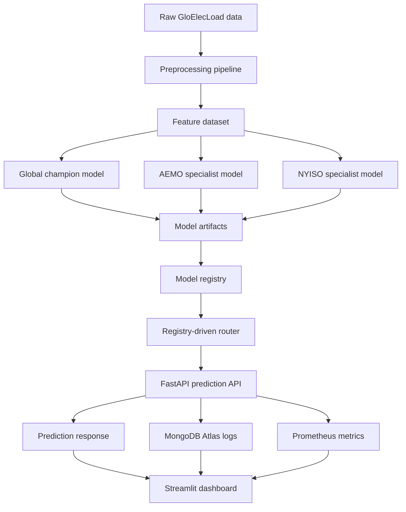

# ⚡ GridGuard AI — Enterprise MLOps Grid Forecasting Platform

GridGuard AI is an enterprise-oriented MLOps platform for next-hour electricity-load forecasting, regional model routing, anomaly screening, monitoring, and decision-support visualization.

The project demonstrates a production-style architecture with:

- FastAPI prediction service.
- Streamlit executive dashboard.
- Registry-driven champion–specialist model routing.
- Global fallback model.
- AEMO and NYISO regional specialist models.
- P10/P90 prediction intervals.
- Operational load bounds.
- Unsupervised anomaly screening.
- MongoDB Atlas prediction logging.
- Prometheus monitoring.
- Docker and Hugging Face deployment support.
- Professional automated test suite.

---

## 1. Why this project matters

Electricity demand is becoming harder to manage because of:

- AI/data-center growth.
- Electrification.
- Renewable variability.
- Regional demand volatility.
- Smart-grid modernization.

GridGuard AI addresses this by forecasting short-term electricity load and showing which model made the prediction, why it was selected, and whether the system used a regional specialist or fallback model.

---

## 2. Key features

| Feature | Description |
|---|---|
| Next-hour load forecast | Predicts next-hour electricity demand in MW |
| Champion–specialist architecture | Uses global fallback plus approved regional specialists |
| Registry-driven routing | No hardcoded market routing in application logic |
| Prediction intervals | Returns P10/P90 range and operational bounds |
| Anomaly screening | Flags unusual load patterns |
| MongoDB Atlas logging | Stores predictions, routing metadata, latency, and feedback |
| Prometheus metrics | Exposes request count, errors, latency, routing counters |
| Streamlit dashboard | Business-friendly decision-support interface |
| Professional tests | API, routing, registry, artifacts, dashboard, and data contracts |

---

## 3. Architecture



```mermaid
flowchart TD
    A[Raw GloElecLoad data] --> B[Preprocessing]
    B --> C[Feature dataset]

    C --> D[Global champion model]
    C --> E[AEMO specialist model]
    C --> F[NYISO specialist model]

    D --> G[Model artifacts]
    E --> G
    F --> G

    G --> H[Model registry]
    H --> I[Registry-driven router]

    I --> J[FastAPI prediction API]
    J --> K[Prediction response]
    J --> L[MongoDB Atlas logs]
    J --> M[Prometheus metrics]

    K --> N[Streamlit dashboard]
    L --> N
    M --> N

<!-- GRIDGUARD_README_PRODUCTION_READINESS_START -->
## Production readiness and safeguards

GridGuard AI is an enterprise-oriented MLOps forecasting platform prototype. It demonstrates production-style architecture, but real mission-critical deployment requires additional operational controls.

### Recommended safeguards before real deployment

- Human-in-the-loop review.
- Drift monitoring.
- Periodic retraining.
- Backtesting on new regions.
- Model registry approval workflow.
- Production-grade logging and alerting.
- Authentication and access control.
- Operational SLAs.

### Recommended production maintenance

- Run CI tests on every commit.
- Rebuild the model registry after every specialist training run.
- Retrain models on a scheduled basis.
- Monitor WMAPE, MAE, RMSE, latency, and routing distribution.
- Investigate markets with high worst-series WMAPE.
- Promote specialists only when they beat the global model by the configured threshold.

### Current limitations

- Anomaly detection is unsupervised.
- The system is validated for next-hour forecasting only.
- Real production deployment requires authentication, access control, drift monitoring, and operational SLAs.
- Model artifacts may need Git LFS or external model storage for large deployments.

Full production-readiness notes are available in:

`docs/PRODUCTION_READINESS.md`
<!-- GRIDGUARD_README_PRODUCTION_READINESS_END -->
