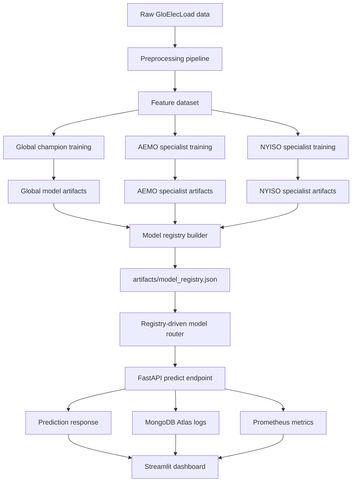

# GridGuard AI Architecture

## 1. System overview

GridGuard AI is a registry-driven MLOps platform for next-hour electricity-load forecasting.

It includes:

- Data preprocessing pipeline.
- Global champion model.
- Regional specialist models.
- Model registry.
- FastAPI prediction API.
- Streamlit dashboard.
- Prometheus monitoring.
- MongoDB Atlas logging.
- Docker and Hugging Face deployment support.
- Automated professional tests.

---

## 2. Architecture diagram



```mermaid
flowchart TD
    A[Raw GloElecLoad data] --> B[Preprocessing pipeline]
    B --> C[Feature dataset]

    C --> D[Global champion training]
    C --> E[AEMO specialist training]
    C --> F[NYISO specialist training]

    D --> G[Global model artifacts]
    E --> H[AEMO specialist artifacts]
    F --> I[NYISO specialist artifacts]

    G --> J[Model registry builder]
    H --> J
    I --> J

    J --> K[artifacts/model_registry.json]

    K --> L[Registry-driven model router]

    L --> M[FastAPI /predict endpoint]
    M --> N[Prediction response]
    M --> O[MongoDB Atlas logs]
    M --> P[Prometheus metrics]

    N --> Q[Streamlit dashboard]
    P --> Q
    O --> Q

<!-- GRIDGUARD_ARCHITECTURE_OPERATIONAL_GOVERNANCE_START -->
## Operational governance

GridGuard AI follows a governed champion-specialist model-serving pattern.

Production safeguards should include:

- Human-in-the-loop review.
- Drift monitoring.
- Periodic retraining.
- Backtesting on new regions.
- Model registry approval workflow.
- Production-grade logging and alerting.

Specialist models should only be promoted when they beat the global model by the configured threshold and pass artifact validation. After every specialist training run, the model registry should be rebuilt and reviewed before deployment.

The current system is validated for next-hour forecasting only. Anomaly detection is unsupervised, and real production deployment requires authentication, access control, alerting, drift monitoring, and operational SLAs.
<!-- GRIDGUARD_ARCHITECTURE_OPERATIONAL_GOVERNANCE_END -->
